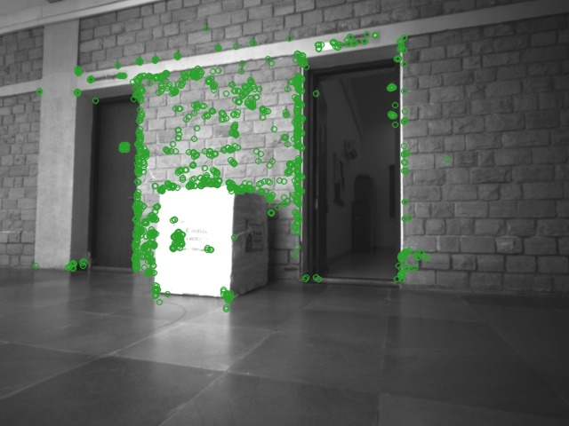
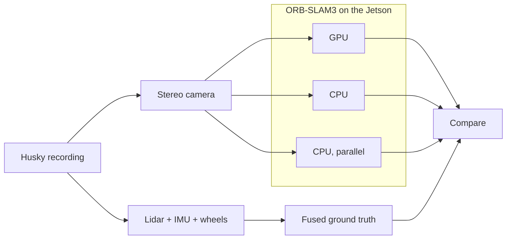
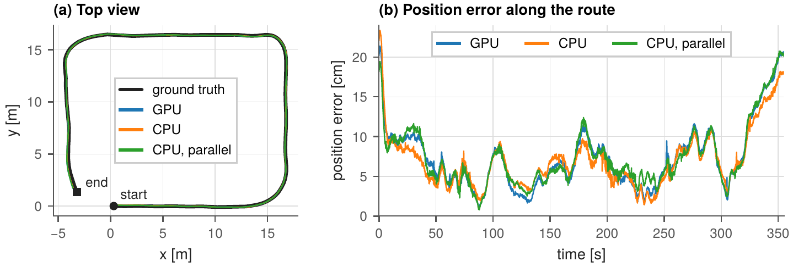
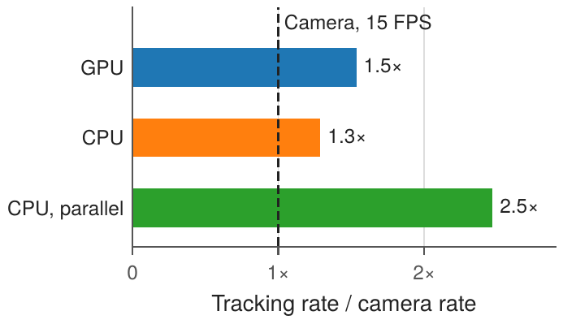

# ORB-SLAM3 on Jetson Orin Nano

**Real-time visual localisation on an embedded GPU, evaluated against a real robot's ground truth.**
DC project report.

Everything we added on top of the original [Jetson-ORB-SLAM3](../README.md) repository lives in this folder.
The ORB-SLAM3 library itself is unchanged; see [Repository layout](#repository-layout).

**Summary.** We ran Jetson-ORB-SLAM3, a GPU-accelerated ORB-SLAM3, on an NVIDIA Jetson Orin Nano with a real
robot recording: a 66 m drive of a Clearpath Husky with an Intel RealSense D435 stereo camera, scored against a
ground-truth trajectory that we fused from the robot's lidar, IMU and wheel encoders. With stereo input the
absolute trajectory error (ATE) of every version is about 8 cm, and the GPU version is as accurate as the original CPU code. All
three versions we tested run faster than the camera. The fastest, at 2.5 times the camera rate, gets its speed
by running feature extraction in parallel on the CPU, not from the GPU. At its peak the board uses about 60 % of
its CPU, under a third of its memory and under 10 W.

## 1. Motivation

A mobile robot builds its map by placing what it observes at the pose it believes it is in, so every error in
localisation ends up in the map: walls appear twice and corridors bend. Reliable localisation is therefore the
basis of mapping and of everything that uses the map, such as navigation.

Visual SLAM estimates the pose from cameras, which are light and rich in information. ORB-SLAM3 is one of the
most accurate open systems: it finds ORB features in every image, tracks them against a map of keyframes and 3D
points, and refines that map in the background with bundle adjustment. This work is heavy, and a small robot can
only carry an embedded board.

Jetson-ORB-SLAM3 moves ORB-SLAM3's feature extraction onto the GPU of the Jetson Orin Nano, continuing earlier
work on embedded GPUs. It reproduces the original detector, so accuracy should not change, and its authors show
this on public benchmark datasets. This project tests the implementation on real hardware with real robot data.

## 2. Objective

The objective is to evaluate Jetson-ORB-SLAM3 on real hardware with real robot data. We break it into four
questions:

| Question | How we test it | What we measure |
|---|---|---|
| **GPU as accurate as CPU?** | GPU and CPU versions on the same recording, 5 runs each | distance from the true path |
| **Can the pipeline run in real time?** | time every processing step of every frame | time per frame vs. time between frames |
| **How much compute does it take?** | log the Jetson's power and compute metrics | power, CPU, GPU and memory use |
| **Ablations on sensors and settings?** | change one sensor or setting at a time | error and power vs. the default setup |

## 3. Approach



*A left IR frame from the Husky recording, with its ORB features (OpenCV, 1250 features).*



*The evaluation. The stereo images drive three versions of ORB-SLAM3 on the Jetson, and each estimated
trajectory is compared with the ground truth that we fused from the robot's lidar, IMU and wheel encoders.*

### 3.1 Platform and data

The board is an NVIDIA Jetson Orin Nano (8 GB, of which 7.6 GB is usable; 6 Arm CPU cores; the CPU and GPU share
the same memory). All runs use the MAXN_SUPER power mode with fixed maximum clocks (`jetson_clocks`).

The data is a ROS 2 recording of a Clearpath Husky robot driving a 65.7 m route in 355 s. SLAM uses the D435's
infrared stereo pair at 640×480 and 15 FPS (5,326 frame pairs). The recording also contains IMU, depth and
colour data, which the ablation uses. We built the ground truth ourselves from the robot's lidar, IMU and wheel
encoders, without using the camera: one GTSAM factor graph combines KISS-ICP lidar odometry, two lidar loop
closures between the end and the start of the route, IMU preintegration and the wheel odometry, whose scale we
calibrated against the lidar. Removing any one of these inputs changes the trajectory by 3–11 cm RMS. The code
is in [`processing/`](processing/), and the ground truth with all its cross-checks is in
[`results/husky/reference/`](results/husky/reference/README.md).

### 3.2 Three versions

All three versions are built from the same code and differ only in how features are extracted:

- **GPU** (the default): ORB features are found on the GPU, then the frame is tracked.
- **CPU** (`CPU_ORB=1`): the original ORB-SLAM3 extractor on the CPU, as the reference.
- **CPU, parallel** (`PIPELINE_FE=1`): a second thread finds the features of the next frame on the CPU while the
  current frame is tracked. This hides extraction behind tracking, at the cost of one frame of delay in the
  output. It does not use the GPU.

### 3.3 Protocol and metrics

Each version replays the recording at the camera rate five times, because ORB-SLAM3 is multithreaded and does
not give identical results twice. Accuracy is the absolute trajectory error (ATE): the root-mean-square distance
between estimated and true positions after the best-fit rotation, translation and scale (Sim(3) alignment).
Every run of every version shows the same constant scale factor of about 1.07; the alignment removes it. A
separate build instrumented by ORB-SLAM3's `REGISTER_TIMES` option times every processing step (one run per
version). During all runs `tegrastats` logs, once per second, the CPU load summed over the six cores, the used
memory, the GPU load and the module's input power (VDD_IN). Peak values are the highest sample of each run, then
the median over runs. The ablation changes one sensor or setting at a time from the stereo GPU baseline and runs
each configuration three times.

## 4. Results

### 4.1 Accuracy



*(a) The estimated trajectories (median run of each version) on the ground truth. (b) The position error of the
same runs along the route.*

| Version | ATE [cm], median (range) | Drift over 10 m | Route tracked |
|---|---|---|---|
| GPU | 8.4 (7.8–9.0) | 1.2 % | 100 %, one map |
| CPU | 7.9 (7.5–8.8) | 1.2 % | 100 %, one map |
| CPU, parallel | 8.3 (7.8–8.6) | 1.2 % | 100 %, one map |

All three versions follow the ground truth closely: the ATE is about 8 cm over the 66 m route, and each version
tracks the whole route in a single map without losing track.

**The GPU version is as accurate as the CPU code.** The difference in median ATE (0.5 cm) is smaller than the
spread between runs of the same version (1.2 cm for both). Without using the ground truth at all, two runs of the
CPU code end up 2.1 cm apart on average (RMS distance between the aligned trajectories), two GPU runs 2.6 cm
apart, and a GPU run and a CPU run 2.5 cm apart: swapping the extractor changes the result no more than running
the same code again.

**The error depends on the scene, not on the implementation.** Along the route the three error curves rise and
fall together. The GPU and CPU curves correlate at 0.97, as closely as two runs of the same code (0.91–0.95), and
differ by 1.0 cm on average. The error is largest at the start, before the map has formed, and towards the end of
the route (about 21 cm); for the GPU version it is below 6.4 cm half the time and below 12.3 cm 90 % of the time.

### 4.2 Speed and resources



*Tracking rate relative to the camera rate (instrumented build).*

| | GPU | CPU | CPU, parallel |
|---|---|---|---|
| Tracking, per frame | 43.4 ms | 51.7 ms | 27.0 ms |
| ORB extraction | 17.9 ms | 26.6 ms | hidden |
| Peak CPU (6 cores) | 57 % | 60 % | 61 % |
| Peak memory (7.6 GB) | 31 % | 31 % | 32 % |
| Peak GPU load | 31 % | 0 % | 0 % |
| Peak power | 9.9 W | 9.9 W | 9.9 W |
| Average power | 9.2 W | 9.2 W | 9.2 W |

*Peaks: median over runs of each run's highest sample.*

**All three versions are real time.** The camera delivers a frame every 66.7 ms; the CPU code tracks one in
51.7 ms and the GPU version in 43.4 ms. The GPU makes feature extraction a third faster (26.6 to 17.9 ms), which
shortens the whole frame by 16 %.

**Running extraction in parallel gains more than moving it to the GPU.** The parallel version tracks a frame in
27.0 ms, 2.5 times the camera rate, without touching the GPU: extraction still takes as long on the CPU, but it
happens while the previous frame is tracked, on a core that would otherwise be idle. This agrees with the
original authors, whose real-time results also come from this mode.

**The board has room to spare.** At its busiest, each version uses about 60 % of the CPU and under a third of the
memory (about 2.4 GB, including the operating system); the GPU version uses the least CPU, which is its main
benefit here. Only the GPU version uses the GPU, at most 31 % of it. Power is the same for all three: 9.9 W at
peak and 9.2 W on average, of which the idle board accounts for 6.6 W. The temperature never exceeded 61 °C and
the CPU clocks stayed at 1.73 GHz throughout, so there was no throttling.

### 4.3 Ablation

One change at a time from the stereo GPU baseline. Speed is the tracking rate relative to the input rate
(instrumented build; "–": not timed). Power is the change in SLAM power, i.e. the module's power above the 6.6 W
idle board.

| Change from the baseline | ATE [cm] | Speed | Power |
|---|---:|---:|---:|
| **Baseline: stereo, GPU** | 8.4 | 1.5× | 2.6 W |
| Parallel extraction (CPU) | 8.3 | 2.5× | −1 % |
| CPU feature extraction | 7.9 | 1.3× | −2 % |
| Half the frame rate (7.5 FPS) | 7.7 | 3.2× | −29 % |
| 800 instead of 1250 features | 8.2 | 2.1× | −22 % |
| Depth camera instead of stereo (colour + depth) | 9.0 | – | −4 % |
| Depth camera instead of stereo (IR + depth) | 12.3 | – | ±0 % |
| Add the IMU | 21.9 | 1.6× | −30 % |
| Add the IMU, with adaptive features | 20.6 | 2.6× | −51 % |
| One camera + IMU (2 of 3 runs) | 40.3 | – | −25 % |
| One camera instead of two | 213 | 3.2× | −35 % |

The baseline and the first two rows come from the five-run experiment above, the others from three runs each.
Every configuration, with all its metrics, is in [`results/husky/ablation_cells.json`](results/husky/ablation_cells.json).

**Stereo is what keeps the error low.** With one camera instead of two the error grows 25-fold, to about two
metres: a single camera cannot measure depth, so the scale of the map drifts along the route even after the
best-fit alignment. A depth camera in place of stereo keeps the error close to the baseline with the colour image
(9.0 cm) but not with the IR image (12.3 cm).

**The IMU does not help on this drive.** Adding it raises the error from 8.4 to about 22 cm. Most likely the robot
moves too gently and slowly for the IMU to estimate its own biases, so it adds noise rather than information. In
this mode ORB-SLAM3 also keeps about half as many keyframes (369 instead of 682 in the instrumented runs).

**Halving the frame rate or using 800 features costs no accuracy.** Both keep the error at the baseline level and
lower SLAM power by 29 and 22 %. With 800 features the tracking rate also rises to 2.1 times the input rate.

## 5. Future work

- **Our own robot, live.** Run ORB-SLAM3 on board our own platform and fuse its GPU visual odometry with
  lidar-inertial odometry and IMU preintegration, so each sensor covers the others' weak spots.
- **Parallel extraction on the GPU.** Combine the two front ends: find the next frame's features on the GPU while
  the current frame is tracked. Throughput would stay about the same, since tracking sets the pace, but it would
  free CPU cores for the rest of the robot's software.
- **More demanding data.** Longer routes and faster motion, where the IMU should help rather than hurt.

---

## Repository layout

The ORB-SLAM3 library itself is unchanged: `src/`, `include/`, `Thirdparty/` and `Vocabulary/` are exactly as
published. The only additions outside `eval/` are:

| File | Purpose |
|---|---|
| `Examples/Stereo/stereo_realsense_D435_rover.cc` | Live driver for our rover (D435 stereo, clean exit, saved trajectories, event log) |
| `Examples/Stereo/RealSense_D435.yaml` | Calibration of our D435 (serial 827312071682) |
| `CMakeLists.txt` | +6 lines to build that driver |
| `.gitignore` | Local-only files (papers, video, notes, raw run data, report and slide sources) |

```
eval/
├── README.md           this report
├── figures/            the figures above
├── benchmark/          run on the Jetson: experiment runner, scoring
│   ├── run_matrix.py       runs a suite of ORB-SLAM3 configurations (GPU / CPU / parallel, ablation cells)
│   ├── common.py           datasets, modes (stereo, mono, inertial, RGB-D), arms (env switches)
│   ├── evaluate.py         ATE (SE(3)/Sim(3)), relative errors, power, per-stage timing per run
│   ├── make_report.py      paper-reproduction report (EuRoC / TUM-VI / KITTI / D435 tables)
│   ├── fetch_datasets.py   EuRoC, TUM-VI, KITTI downloads
│   ├── setup_timing_build.sh   instrumented (REGISTER_TIMES) build in a separate worktree
│   ├── paper_reference.py  the paper's published numbers
│   ├── cpp/                D435 recorder (EuRoC layout) and ORB feature-equivalence tool
│   └── tools/              CosPlace ONNX export
├── processing/         processes the ROS 2 bag: datasets, ground truth, analysis
│   ├── inspect_bag.py, bag_to_euroc.py, bag_odom.py      read a ROS 2 bag; extract IR stereo in EuRoC layout
│   ├── fuse_reference.py   ground truth from lidar + IMU + wheels (GTSAM factor graph, extrinsic checks)
│   ├── lidar_odometry.py, lidar_slam.py, reference_check.py   lidar-only cross-checks of the reference
│   ├── make_gt.py          reference -> camera / IMU / colour frame at every image time (gt.csv)
│   ├── prepare_husky.sh    the whole ground-truth pipeline for one bag
│   ├── ablation_prepare.py IMU, depth and colour extraction + the ablation variant folders
│   ├── husky_report.py, ablation_report.py, analyze_d435.py   reports from run results
│   ├── jetson_prepare.sh   install the reference next to the IR sequence on the Jetson
│   └── setup_venv.sh       Python environment (--light on the Jetson)
├── rover/              live rover runs with the D435 driver (rover_run.sh, summarize_run.py)
└── results/husky/      the Husky recording
    ├── ablation_cells.json every ablation configuration with all its metrics
    └── reference/          ground truth (sequence/gt.csv), how it was built, its cross-checks
```

Kept local and out of the repository (see `.gitignore`): the raw run outputs (trajectories, console and
tegrastats logs, per-run JSON), the generated run reports, our own D435 recording campaigns, and the report and
slides with their sources.

## Running

**On the Jetson** (system Python), with a sequence in `~/datasets/ext/<name>/` (images, `times.txt`,
`settings.yaml`, `gt.csv`):

```bash
sudo nvpmodel -m 2 && sudo jetson_clocks
python3 eval/benchmark/run_matrix.py ext --engine /nonexistent --results ~/repro_results_ext
python3 eval/benchmark/run_matrix.py abl --seqs husky_20261023__si --arms gpu cpu --results ~/repro_results_abl
python3 eval/benchmark/run_matrix.py ext --runs 1 --build-root ~/Jetson-ORB-SLAM3-timing --results ~/repro_results_ext_timing
```

**Processing the ROS 2 bag** (any machine; `eval/processing/setup_venv.sh`; the full set needs Python 3.12 for kiss-icp). The run results go
under `eval/results/husky/{stage1,ablation}/` (local only):

```bash
eval/processing/prepare_husky.sh                         # bag -> IR sequence + fused ground truth
~/venvs/ext/bin/python -I eval/processing/ablation_prepare.py
H=eval/results/husky
~/venvs/ext/bin/python -I eval/processing/husky_report.py --results $H/stage1/runs --timing $H/stage1/timing \
    --seq ~/datasets/ext/husky_20261023 --reference $H/reference --out $H/stage1/report
~/venvs/ext/bin/python -I eval/processing/ablation_report.py --stage1 $H/stage1/runs --abl $H/ablation/runs \
    --data ~/datasets/ext --reference $H/reference --out $H/ablation/report \
    --stage1-timing $H/stage1/timing --abl-timing $H/ablation/timing --idle $H/ablation/idle_tegrastats.log
```
