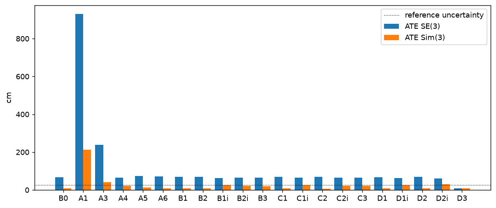
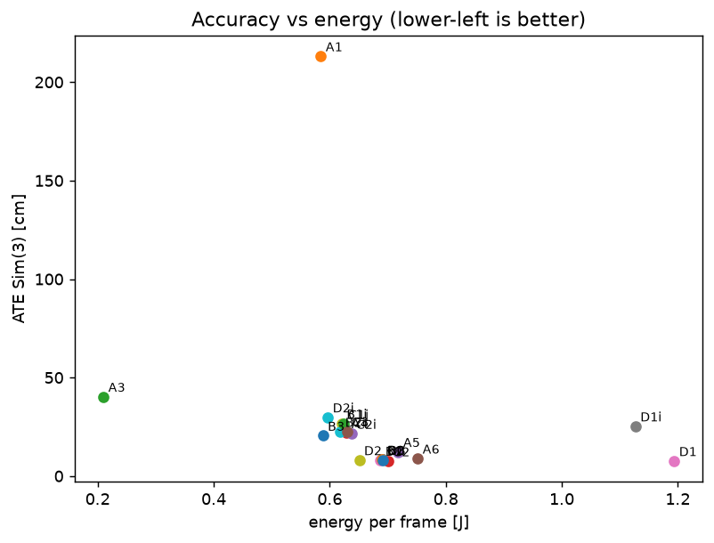

# Ablation study: Husky `husky_20261023`, Jetson ORB-SLAM3 vs the fused reference

One factor changed per cell from **B0** (stereo IR, GPU ORB, DBoW2 loop closure, 15 FPS, 1250 features). Medians over runs, min–max in brackets. Every run is scored against the reference in its own output frame. Reference uncertainty ≈ **27 cm**: smaller differences are not resolvable.

**Note on scale.** Stage 1 found ORB-SLAM3 stereo distances ~6.4%% short of the lidar on this camera (Sim(3) scale ≈ 1.07). That error dominates SE(3) ATE, so SE(3) and Sim(3) ATE are both shown: SE(3) includes the scale error, Sim(3) shows the shape. Cell D3 tests the calibration hypothesis directly.

## 1. All cells

| Cell | Configuration | Runs ok | ATE SE(3) [cm] | ATE Sim(3) [cm] | Scale | RPE 10 m [%] | Coverage [%] | Loops | Maps | NaN aborts | Δ vs B0 |
|---|---|---|---|---|---|---|---|---|---|---|---|
| B0 | stereo IR, GPU ORB, DBoW2 (stage 1) | 5/5 | 68.1 (67.8–71.5) | 8.4 (7.8–9.0) | 1.069 | 6.17 | 100.0 | 0 | 1 | 0 |  |
| A1 | mono IR *(Sim(3) primary: mono has no scale)* | 3/3 | 930.2 (922.1–932.7) | 213.2 (95.1–218.4) | 8.898 | 82.90 | 99.2 | 0 | 1 | 0 | **+204.8 cm: worse** |
| A3 | mono IR + IMU | 2/3 | 239.0 (174.8–303.2) | 40.3 (35.2–45.5) | 6.918 | 89.23 | 16.4 | 0 | 5 | 0 | **+170.9 cm: worse** |
| A4 | stereo IR + IMU | 3/3 | 64.2 (63.1–65.4) | 21.9 (18.5–22.2) | 1.062 | 5.83 | 99.3 | 0 | 1 | 0 | -3.9 cm: below reference uncertainty |
| A5 | RGB-D mode: IR + depth | 3/3 | 72.9 (72.2–74.7) | 12.3 (11.7–13.1) | 1.074 | 6.30 | 100.0 | 0 | – | 0 | +4.8 cm: below reference uncertainty |
| A6 | RGB-D mode: colour + depth | 3/3 | 71.3 (69.2–72.4) | 9.0 (8.7–9.7) | 1.073 | 6.27 | 100.0 | 0 | – | 0 | +3.3 cm: within run-to-run |
| B1 | stereo, CPU ORB (stage 1) | 5/5 | 69.1 (67.6–69.4) | 7.9 (7.5–8.7) | 1.070 | 6.21 | 100.0 | 0 | 1 | 0 | +1.1 cm: within run-to-run |
| B2 | stereo, PIPELINE_FE (stage 1) | 4/5 | 69.1 (68.3–70.2) | 8.3 (7.8–8.6) | 1.070 | 6.24 | 100.0 | 0 | 1 | 1 | +1.0 cm: within run-to-run |
| B1i | stereo + IMU, CPU ORB | 3/3 | 63.6 (62.9–65.1) | 26.8 (22.6–27.1) | 1.059 | 5.83 | 99.3 | 0 | 1 | 0 | -4.4 cm: below reference uncertainty |
| B2i | stereo + IMU, PIPELINE_FE | 3/3 | 65.9 (65.9–66.0) | 22.5 (17.0–31.2) | 1.063 | 5.94 | 99.2 | 0 | 1 | 0 | -2.2 cm: within run-to-run |
| B3 | stereo + IMU, ADAPTIVE_FE | 3/3 | 65.4 (65.0–66.9) | 20.6 (17.8–21.7) | 1.064 | 6.02 | 99.3 | 0 | 1 | 0 | -2.7 cm: within run-to-run |
| C1 | stereo, no loop closing | 3/3 | 68.7 (68.2–69.7) | 8.4 (8.3–8.5) | 1.070 | 6.24 | 100.0 | 0 | 1 | 0 | +0.6 cm: within run-to-run |
| C1i | stereo + IMU, no loop closing | 3/3 | 64.0 (63.6–65.8) | 26.5 (21.4–31.9) | 1.061 | 5.82 | 99.3 | 0 | 1 | 0 | -4.0 cm: below reference uncertainty |
| C2 | stereo, DBoW2 + CNN | 3/3 | 69.3 (66.9–69.6) | 7.6 (7.4–8.0) | 1.071 | 6.26 | 100.0 | 0 | 1 | 0 | +1.2 cm: within run-to-run |
| C2i | stereo + IMU, DBoW2 + CNN | 3/3 | 65.2 (64.6–65.8) | 21.5 (14.7–24.8) | 1.062 | 5.91 | 99.3 | 0 | 1 | 0 | -2.9 cm: within run-to-run |
| C3 | stereo + IMU, ADAPTIVE_LC | 3/3 | 64.7 (63.2–65.1) | 22.7 (20.7–29.4) | 1.062 | 5.83 | 99.3 | 0 | 1 | 0 | -3.3 cm: within run-to-run |
| D1 | stereo, 7.5 FPS | 3/3 | 67.3 (66.8–69.6) | 7.7 (7.4–8.0) | 1.069 | 6.13 | 100.0 | 0 | 1 | 0 | -0.8 cm: within run-to-run |
| D1i | stereo + IMU, 7.5 FPS | 3/3 | 63.6 (62.5–63.7) | 25.3 (25.1–28.2) | 1.059 | 5.76 | 99.2 | 0 | 1 | 0 | -4.4 cm: below reference uncertainty |
| D2 | stereo, 800 features | 3/3 | 70.1 (68.4–70.3) | 8.2 (7.9–8.5) | 1.072 | 6.28 | 100.0 | 0 | 1 | 0 | +2.0 cm: within run-to-run |
| D2i | stereo + IMU, 800 features | 3/3 | 60.7 (60.7–61.4) | 29.9 (26.2–34.3) | 1.053 | 5.50 | 99.3 | 0 | 1 | 0 | -7.3 cm: below reference uncertainty |
| D3 | stereo, baseline x1.068 (calibration test) | 3/3 | 8.7 (8.4–8.8) | 8.2 (7.9–8.6) | 1.003 | 1.28 | 100.0 | 0 | 1 | 0 | **-59.4 cm: better** |

Inertial cells: runs that completed IMU initialisation (`end VIBA 1`), and 'Not enough motion for initializing' resets (the Husky turns at most ~7°/s): A3 3/3 (15 resets), A4 3/3 (0 resets), B1i 3/3 (0 resets), B2i 3/3 (0 resets), B3 3/3 (0 resets), C1i 3/3 (0 resets), C2i 3/3 (0 resets), C3 3/3 (0 resets), D1i 3/3 (0 resets), D2i 3/3 (0 resets).

## 2. Compute (tegrastats, median over runs; replay paced to 15 FPS)

| Cell | Configuration | CPU [%] | GPU [%] | VDD_IN [W] | Energy per frame [J] |
|---|---|---|---|---|---|
| B0 | stereo IR, GPU ORB, DBoW2 (stage 1) | 252 | 6.4 | 9.21 | 0.691 |
| A1 | mono IR | 129 | 3.1 | 8.30 | 0.585 |
| A3 | mono IR + IMU | 157 | 9.7 | 8.57 | 0.210 |
| A4 | stereo IR + IMU | 146 | 5.7 | 8.44 | 0.629 |
| A5 | RGB-D mode: IR + depth | 272 | 3.2 | 9.22 | 0.718 |
| A6 | RGB-D mode: colour + depth | 248 | 2.7 | 9.12 | 0.752 |
| B1 | stereo, CPU ORB (stage 1) | 280 | 0.0 | 9.15 | 0.688 |
| B2 | stereo, PIPELINE_FE (stage 1) | 284 | 0.0 | 9.17 | 0.691 |
| B1i | stereo + IMU, CPU ORB | 176 | 0.0 | 8.42 | 0.621 |
| B2i | stereo + IMU, PIPELINE_FE | 175 | 0.0 | 8.40 | 0.618 |
| B3 | stereo + IMU, ADAPTIVE_FE | 99 | 3.3 | 7.89 | 0.588 |
| C1 | stereo, no loop closing | 249 | 6.1 | 9.19 | 0.691 |
| C1i | stereo + IMU, no loop closing | 140 | 6.2 | 8.39 | 0.624 |
| C2 | stereo, DBoW2 + CNN | 260 | 6.2 | 9.31 | 0.701 |
| C2i | stereo + IMU, DBoW2 + CNN | 154 | 6.4 | 8.57 | 0.637 |
| C3 | stereo + IMU, ADAPTIVE_LC | 146 | 5.7 | 8.43 | 0.630 |
| D1 | stereo, 7.5 FPS | 172 | 2.9 | 8.45 | 1.194 |
| D1i | stereo + IMU, 7.5 FPS | 111 | 3.2 | 8.02 | 1.127 |
| D2 | stereo, 800 features | 198 | 5.4 | 8.65 | 0.651 |
| D2i | stereo + IMU, 800 features | 103 | 5.7 | 8.01 | 0.597 |
| D3 | stereo, baseline x1.068 (calibration test) | 254 | 6.1 | 9.22 | 0.692 |

Idle board (MAXN_SUPER + jetson_clocks): **6.64 W**. SLAM's own cost per cell = VDD_IN − idle:

| Cell | Configuration | SLAM power above idle [W] | vs B0 |
|---|---|---|---|
| B0 | stereo IR, GPU ORB, DBoW2 (stage 1) | 2.57 | +0% |
| A1 | mono IR | 1.66 | -35% |
| A3 | mono IR + IMU | 1.93 | -25% |
| A4 | stereo IR + IMU | 1.80 | -30% |
| A5 | RGB-D mode: IR + depth | 2.58 | +0% |
| A6 | RGB-D mode: colour + depth | 2.48 | -4% |
| B1 | stereo, CPU ORB (stage 1) | 2.51 | -2% |
| B2 | stereo, PIPELINE_FE (stage 1) | 2.53 | -1% |
| B1i | stereo + IMU, CPU ORB | 1.77 | -31% |
| B2i | stereo + IMU, PIPELINE_FE | 1.76 | -31% |
| B3 | stereo + IMU, ADAPTIVE_FE | 1.25 | -51% |
| C1 | stereo, no loop closing | 2.55 | -1% |
| C1i | stereo + IMU, no loop closing | 1.75 | -32% |
| C2 | stereo, DBoW2 + CNN | 2.66 | +4% |
| C2i | stereo + IMU, DBoW2 + CNN | 1.93 | -25% |
| C3 | stereo + IMU, ADAPTIVE_LC | 1.79 | -30% |
| D1 | stereo, 7.5 FPS | 1.81 | -29% |
| D1i | stereo + IMU, 7.5 FPS | 1.38 | -46% |
| D2 | stereo, 800 features | 2.00 | -22% |
| D2i | stereo + IMU, 800 features | 1.37 | -47% |
| D3 | stereo, baseline x1.068 (calibration test) | 2.57 | +0% |

### Per-frame cost (REGISTER_TIMES build, 1 run per cell) [ms]

True processing cost, independent of the 15 FPS pacing. The budget is 66.7 ms per frame at 15 FPS (133 ms at 7.5 FPS). Local mapping is per keyframe, in its own thread.

| Cell | Configuration | ORB extr. | Stereo match | IMU preint. | LM track | **Total tracking** | **FPS** | Local mapping / KF | KFs | LBA runs |
|---|---|---|---|---|---|---|---|---|---|---|
| B0 | stereo IR, GPU ORB, DBoW2 (stage 1) | 17.9 | 7.2 | – | 10.7 | 43.4 | 23.0 | 366 | 682 | 622 |
| A1 | mono IR | 7.9 | – | – | 7.2 | 21.0 | 47.7 | 446 | 506 | 766 |
| A3 | mono IR + IMU | – | – | – | – | – | – | – | – | – |
| A4 | stereo IR + IMU | 15.5 | 7.2 | 0.10 | 16.8 | 42.3 | 23.6 | 345 | 369 | 878 |
| A5 | RGB-D mode: IR + depth | 9.5 | – | – | 14.1 | – | – | 300 | 1099 | 597 |
| A6 | RGB-D mode: colour + depth | 9.4 | – | – | 10.5 | – | – | 498 | 579 | 565 |
| B1 | stereo, CPU ORB (stage 1) | 26.6 | 7.2 | – | 10.5 | 51.7 | 19.3 | 357 | 683 | 637 |
| B2 | stereo, PIPELINE_FE (stage 1) | 0.0 | 7.6 | – | 11.3 | 27.0 | 37.0 | 344 | 724 | 654 |
| B1i | stereo + IMU, CPU ORB | 25.3 | 7.1 | 0.10 | 16.6 | 51.7 | 19.4 | 343 | 357 | 887 |
| B2i | stereo + IMU, PIPELINE_FE | 0.0 | 7.3 | 0.16 | 16.2 | 26.2 | 38.1 | 334 | 376 | 899 |
| B3 | stereo + IMU, ADAPTIVE_FE | 8.4 | 4.0 | 0.09 | 11.2 | 25.4 | 39.4 | 206 | 353 | 1010 |
| C1 | stereo, no loop closing | 17.5 | 7.1 | – | 10.4 | 42.5 | 23.5 | 357 | 684 | 628 |
| C1i | stereo + IMU, no loop closing | 15.4 | 7.0 | 0.10 | 16.7 | 41.8 | 23.9 | 343 | 359 | 882 |
| C2 | stereo, DBoW2 + CNN | 20.4 | 7.1 | – | 10.7 | 45.9 | 21.8 | 366 | 677 | 629 |
| C2i | stereo + IMU, DBoW2 + CNN | 17.9 | 7.1 | 0.10 | 16.8 | 44.6 | 22.4 | 349 | 372 | 872 |
| C3 | stereo + IMU, ADAPTIVE_LC | 15.3 | 6.9 | 0.10 | 16.7 | 41.6 | 24.0 | 344 | 373 | 878 |
| D1 | stereo, 7.5 FPS | 17.0 | 7.2 | – | 10.0 | 41.3 | 24.2 | 390 | 540 | 527 |
| D1i | stereo + IMU, 7.5 FPS | 15.4 | 6.9 | 0.12 | 16.3 | 41.3 | 24.2 | 337 | 379 | 806 |
| D2 | stereo, 800 features | 16.2 | 4.4 | – | 6.2 | 31.4 | 31.8 | 244 | 493 | 494 |
| D2i | stereo + IMU, 800 features | 14.4 | 4.4 | 0.08 | 11.0 | 31.6 | 31.6 | 210 | 369 | 913 |
| D3 | stereo, baseline x1.068 (calibration test) | 17.6 | 7.2 | – | 10.6 | 42.9 | 23.3 | 364 | 671 | 620 |

## 3. Non-visual baselines (same reference, same metric)

| Cell | Trajectory | ATE SE(3) [cm] | ATE Sim(3) [cm] | Scale | RPE 10 m [%] |
|---|---|---|---|---|---|
| E1 | wheels (/platform/odom) | 53.6 | 9.1 | 0.952 | 6.20 |
| E2 | robot EKF (/platform/odom/filtered) | 53.6 | 9.1 | 0.952 | 6.20 |
| E3 | lidar only (KISS-ICP, no loops) | 44.3 | 44.1 | 0.996 | 1.69 |

E3 shares the lidar with the reference, so it is not an independent comparison.

## 4. Plots

