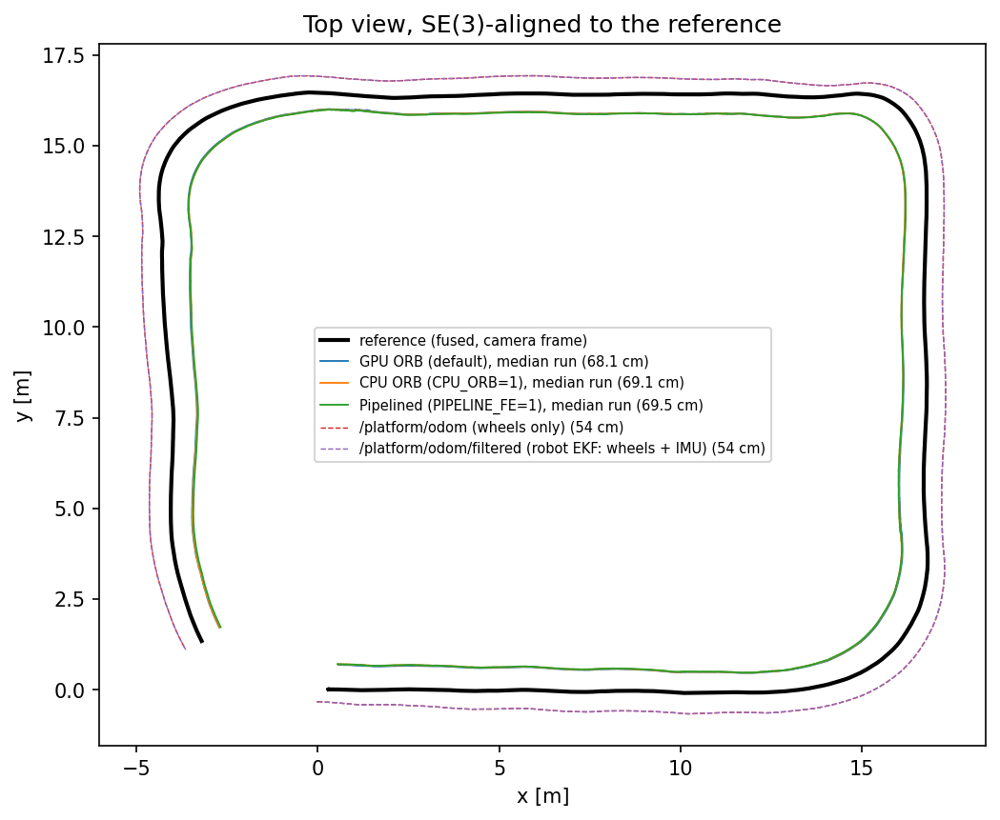
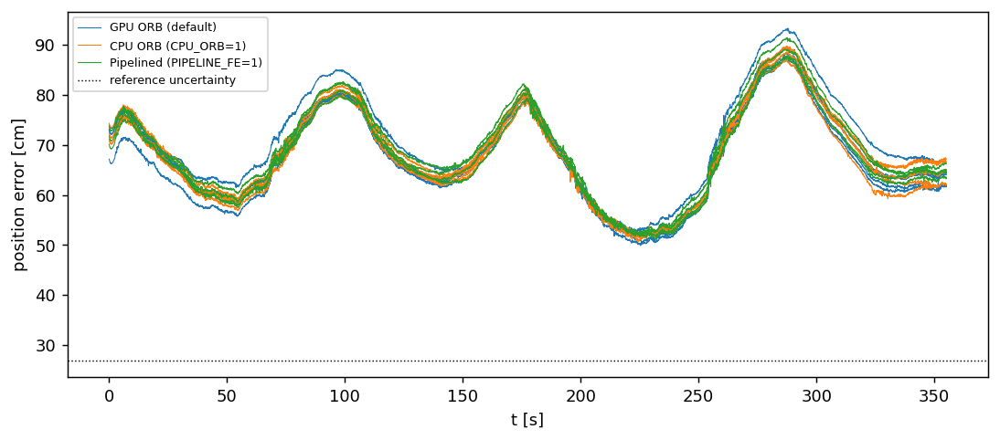
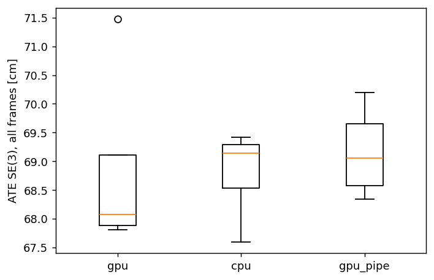

# Jetson ORB-SLAM3 vs fused reference: Husky dataset `husky_20261023`

Our camera-only pipeline (stereo IR, `Examples/Stereo/stereo_euroc`, the R6 ORB settings) on the other team's Husky recording, scored against a reference built from **every non-camera sensor** in the bag.

## 1. Data and reference

| | |
|---|---|
| Sequence | 5326 stereo pairs, 355.2 s, 15.0 FPS, 640×480 IR, projector off |
| Reference | GTSAM factor graph: KISS-ICP lidar odometry + lidar loop closures + IMU preintegration + wheel odometry + IMU roll/pitch |
| Reference path | 65.6 m, end-to-start 3.70 m, z range 0.34 m |
| Factors | IMU True, wheel 3550, roll/pitch 0, loop closures 2 |
| Magnetometer | excluded: |B| varies 28% over the run |
| Validation only | /platform/odom/filtered, /tf odom->base_link, /imu/rpy, /platform/joint_states |
| Camera topics used by the reference | none |
| Reference in camera frame | `gt.csv`: 5324 poses (T_base_cam from /tf_static) |
| Reference uncertainty (estimate) | **~27 cm**: max of RMS change without loop closure 11.2 cm; half the loop correction on the pass-1 trajectory 26.9 cm. Differences below this are not resolvable; details in `jetson-orbslam3-results-husky/reference/fusion/reference_check.md` |

## 2. Accuracy (median over runs, min–max in brackets)

| Metric | GPU ORB (default) | CPU ORB (CPU_ORB=1) | Pipelined (PIPELINE_FE=1) |
|---|---|---|---|
| **ATE SE(3), keyframes [cm]** (paper Table 1 metric) | 66.98 (66.58–70.42) | 67.91 (66.30–68.36) | 67.85 (67.36–69.14) |
| ATE SE(3), all frames [cm] | 68.07 (67.81–71.48) | 69.14 (67.60–69.41) | 69.06 (68.34–70.20) |
| ATE horizontal (yaw + xy alignment), all frames [cm] | 771.87 (770.92–772.69) | 771.34 (770.96–772.89) | 772.67 (770.34–774.42) |
| Height error RMS after SE(3) alignment [cm] | 2.89 (2.80–3.00) | 2.77 (2.60–3.26) | 2.87 (2.67–3.62) |
| ATE Sim(3), all frames [cm] | 8.39 (7.80–9.00) | 7.89 (7.52–8.75) | 8.30 (7.75–8.59) |
| Scale (Sim(3)), all frames | 1.0693 (1.0690–1.0730) | 1.0704 (1.0687–1.0709) | 1.0705 (1.0696–1.0716) |
| Max position error [cm] | 88.4 (87.1–93.3) | 89.6 (87.1–89.7) | 88.5 (87.7–91.5) |
| RPE translation over 1 m [%] | 7.10 (7.07–7.17) | 7.15 (7.08–7.18) | 7.17 (7.14–7.20) |
| RPE rotation over 1 m [deg/100 m] | 16.26 (16.05–16.60) | 16.43 (15.68–16.77) | 16.28 (16.21–16.42) |
| RPE translation over 5 m [%] | 6.48 (6.47–6.57) | 6.54 (6.47–6.55) | 6.57 (6.52–6.60) |
| RPE rotation over 5 m [deg/100 m] | 10.32 (10.09–10.41) | 10.54 (10.11–10.85) | 10.37 (10.14–10.57) |
| RPE translation over 10 m [%] | 6.17 (6.15–6.27) | 6.21 (6.16–6.24) | 6.24 (6.21–6.29) |
| RPE rotation over 10 m [deg/100 m] | 9.07 (8.88–9.37) | 9.33 (8.96–9.61) | 9.08 (8.93–9.51) |
| Coverage (images with a pose) [%] | 100.0 (100.0–100.0) | 100.0 (100.0–100.0) | 100.0 (100.0–100.0) |
| Time to first pose [s] | 0.00 (0.00–0.00) | 0.00 (0.00–0.00) | 0.00 (0.00–0.00) |
| Loops closed | 0 (0–0) | 0 (0–0) | 0 (0–0) |
| Maps at the end | 1 (1–1) | 1 (1–1) | 1 (1–1) |
| 'Fail to track local map' events | 0 (0–0) | 0 (0–0) | 0 (0–0) |

Runs per arm: gpu 5 (5 with a trajectory), cpu 5 (5 with a trajectory), gpu_pipe 5 (4 with a trajectory).

### Context: the robot's own odometry against the same reference

| Trajectory | ATE SE(3) [cm] | Max [cm] | RPE 10 m [%] |
|---|---|---|---|
| /platform/odom (wheels only) | 53.61 | 65.0 | 6.20 |
| /platform/odom/filtered (robot EKF: wheels + IMU) | 53.60 | 65.0 | 6.20 |
| **Our ORB-SLAM3, GPU (median)** | 68.07 | | |

## 3. GPU ≡ CPU (and pipelining) against real reference poses

| Comparison | Δ median ATE, frames [cm] | Spread A [cm] | Spread B [cm] | Verdict |
|---|---|---|---|---|
| gpu vs cpu | 1.06 | 3.67 | 1.82 | equivalent (within run-to-run spread) |
| gpu vs gpu_pipe | 0.99 | 3.67 | 1.85 | equivalent (within run-to-run spread) |
| cpu vs gpu_pipe | 0.08 | 1.82 | 1.85 | equivalent (within run-to-run spread) |

A difference counts only if it is larger than the run-to-run spread of both arms and than the reference uncertainty (§1).

Reference-free check (no ground truth involved, as in R6): median RMS distance between SE(3)-aligned trajectories [cm]. Cross-arm distances should not exceed the run-to-run distances.

| Pair | Distance [cm] | Pairs |
|---|---|---|
| gpu vs cpu | 2.46 | 25 |
| gpu vs gpu | 2.61 | 10 |
| cpu vs cpu | 2.11 | 10 |
| gpu vs gpu_pipe | 2.69 | 20 |
| gpu_pipe vs gpu_pipe | 3.30 | 6 |

## 4. Compute (tegrastats over the tracking window, median over runs)

Replay is paced to the camera (15 FPS): an arm that keeps up spends the same wall time, so CPU/GPU load and energy per frame are the efficiency comparison. True per-frame cost comes from the instrumented runs.

| Metric | GPU ORB (default) | CPU ORB (CPU_ORB=1) | Pipelined (PIPELINE_FE=1) |
|---|---|---|---|
| VDD_IN mean [W] | 9.21 | 9.15 | 9.17 |
| VDD_IN peak [W] | 9.89 | 9.85 | 9.85 |
| VDD_CPU_GPU_CV [W] | 3.25 | 3.27 | 3.28 |
| VDD_SOC [W] | 2.71 | 2.68 | 2.69 |
| CPU load, sum of 6 cores [%] | 252 | 280 | 283 |
| GPU load GR3D [%] | 6.4 | 0.0 | 0.0 |
| RAM peak [MB] | 2381 | 2373 | 2436 |
| Tj max [°C] | 58.2 | 58.2 | 58.3 |
| Tracking window [s] | 400 | 400 | 401 |
| Energy per frame [J] | 0.691 | 0.688 | 0.690 |
| Real-time (window ≤ 1.05 × duration) | **no** | **no** | **no** |

### Per-stage timing (REGISTER_TIMES build) [ms/frame]

| Stage | GPU ORB (default) | CPU ORB (CPU_ORB=1) | Pipelined (PIPELINE_FE=1) |
|---|---|---|---|
| ORB Extraction | 17.9 | 26.6 | 0.0 |
| Stereo Matching | 7.2 | 7.2 | 7.6 |
| Pose Prediction | 5.1 | 5.1 | 5.4 |
| LM Track | 10.7 | 10.5 | 11.3 |
| New KF decision | 0.2 | 0.2 | 0.2 |
| Total Tracking | 43.4 | 51.7 | 27.0 |
| Total Local Mapping | 366.0 | 357.4 | 343.7 |
| Throughput 1000/Total Tracking [FPS] | 23.0 | 19.3 | 37.0 |
| Budget at 15 FPS | 66.7 ms | | |

## 5. Run health

| Arm | Run | Exit | Outcome | Coverage [%] | ATE frames [cm] |
|---|---|---|---|---|---|
| gpu | run1 | 135 | bus error (teardown) | 100.0 | 67.88 |
| gpu | run2 | 139 | segfault (teardown) | 100.0 | 68.07 |
| gpu | run3 | 0 | clean | 100.0 | 69.11 |
| gpu | run4 | 0 | clean | 100.0 | 71.48 |
| gpu | run5 | 0 | clean | 100.0 | 67.81 |
| cpu | run1 | 135 | bus error (teardown) | 100.0 | 69.14 |
| cpu | run2 | 0 | clean | 100.0 | 68.53 |
| cpu | run3 | 1 | X error (teardown) | 100.0 | 69.41 |
| cpu | run4 | 0 | clean | 100.0 | 67.60 |
| cpu | run5 | 1 | X error (teardown) | 100.0 | 69.29 |
| gpu_pipe | run1 | 0 | clean | 100.0 | 68.34 |
| gpu_pipe | run2 | 0 | clean | 100.0 | 69.47 |
| gpu_pipe | run3 | 1 | X error (teardown) | 100.0 | 68.65 |
| gpu_pipe | run4 | 0 | clean | 100.0 | 70.20 |
| gpu_pipe | run5 | 134 | Sophus NaN (mid-run) | – | – |

## 6. Plots

Reference construction and its cross-checks: `jetson-orbslam3-results-husky/reference/fusion` (fusion_topview.png, reference_check.png).
